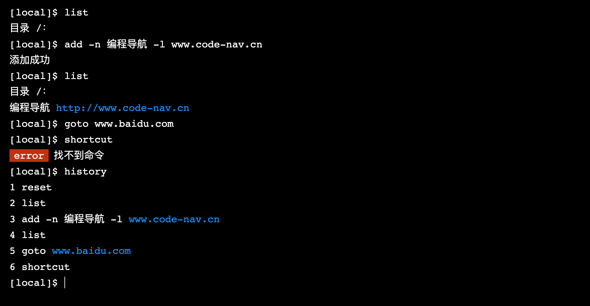
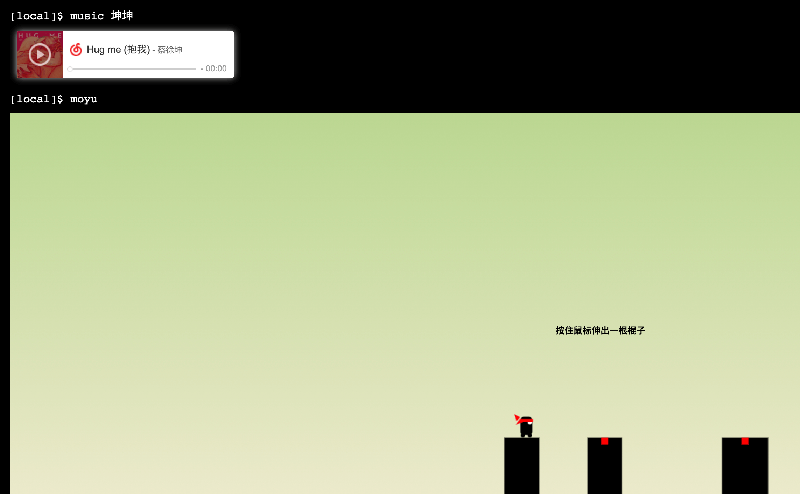

<div align="center">

# 💻 YuIndex — 极客范儿的命令行浏览器主页 & 开源 Web 终端

**Coolest Terminal Browser Startpage & Extensible Web Terminal for Geeks!**

> 一款基于 **Vue 3 + TypeScript + Node.js** 打造的开源全栈命令行浏览器起始页与可复用 Web 终端组件，By [程序员鱼皮](https://docs.qq.com/doc/DUFFRVWladXVjeUxW)

<p>
  <a href="http://yuindex.yupi.icu" target="_blank">
    
  </a>
  <a href="https://www.bilibili.com/video/BV19B4y1Y7m8/" target="_blank">
    
  </a>
  <a href="./doc/commands.md">
    
  </a>
</p>

<p>
  <a href="https://github.com/liyupi/yuindex/stargazers">
    
  </a>
  <a href="https://github.com/liyupi/yuindex/network/members">
    
  </a>
  <a href="./LICENSE">
    
  </a>
  
  
  
  
  
</p>

[项目简介](#-yuindex-是什么) · [1 分钟上手](#-1-分钟上手体验) · [核心功能](#-核心功能与命令一览) · [技术栈](#-技术栈) · [本地运行与部署](#-本地运行与部署) · [系统设计](#-系统设计与架构解析) · [常见问题](#-常见问题-faq) · [贡献指南](#-贡献指南)

</div>

---

> 🔥 **在线体验**：[http://yuindex.yupi.icu](http://yuindex.yupi.icu)（打开即用，无需注册）
>
> 🎬 **视频演示**：[https://www.bilibili.com/video/BV19B4y1Y7m8/](https://www.bilibili.com/video/BV19B4y1Y7m8/)
>
> ⭐ **深度源码与简历实战**：我在自己的 [编程知识星球](https://yupi.icu) 内花了 **4 个小时直播**，带大家从 0 到 1 详细解读了这个项目的**创作思路 + 技术选型 + 系统设计 + 源码解读 + 思路扩展 + 简历亮点写法**。如果你希望深入吃透源码，或把这个项目打造成自己的简历亮点，[欢迎加入我的星球观看完整讲解](https://yupi.icu/%E6%98%9F%E7%90%83%E9%A1%B9%E7%9B%AE/Web%20%E7%BB%88%E7%AB%AF%E9%A1%B9%E7%9B%AE.html)。

---

## ✨ 界面预览




---

## 🚀 YuIndex 是什么？

**YuIndex** 是由 [程序员鱼皮](https://docs.qq.com/doc/DUFFRVWladXVjeUxW) 开源的一款**极客范儿命令行浏览器主页（Geek Terminal Browser Startpage）**，同时也是一个**可独立复用、高度可扩展的开源 Web 终端组件（Web Terminal）**。

- **All-in-One 浏览器效率入口**：打破传统图标导航页的局限，让你无需频繁移动鼠标，通过输入类 Linux 命令即可在一个 Web 终端里高效完成聚合搜索、网页跳转、书签空间管理、待办记录、翻译、查热榜、取变量名、听音乐、玩小游戏等日常高频操作。
- **插件化 Web 终端引擎**：前端采用 Vue 3 + TypeScript 从 0 自研微终端组件与独立命令解析执行引擎，开发者可以直接复用终端组件，或以插件方式将任意前端组件与业务功能集成进终端。
- **开箱即用的 Chrome 新标签页扩展**：除了在线网页版与 Docker 私有化部署，还支持一键打包为 **Chrome 浏览器扩展（CRX）**，直接接管浏览器默认新标签页。
- **高质量前端进阶 / 全栈学习范本**：架构分层清晰、代码规范、抽象度高，覆盖 Vue 3 Composition API、Pinia 状态持久化、自定义命令引擎、Node.js + Express + MySQL + Redis 后端服务等完整全栈工程实践。

> 如果你是一名程序员，相信你会爱上它~ 你可以将音乐、游戏，甚至可以将自己的偶像封装到主页中！




---

## ⚡ 1 分钟上手体验

无需安装任何软件，立即打开在线体验地址 👉 **[http://yuindex.yupi.icu](http://yuindex.yupi.icu)**

在终端中依次输入以下命令，1 分钟感受极客主页的魅力：

```bash
baidu 程序员鱼皮          # 百度快捷搜索
github yuindex           # GitHub 快捷搜索
goto yupi.icu            # 网页快速跳转
todo                     # 打开终端待办事项面板
varbook 极客浏览器主页     # 变量命名助手，自动生成规范英文变量名
music 坤坤                # 终端内直接在线听音乐
moyu                     # 终端内嵌摸鱼小游戏
# 按下 Ctrl + O 触发所有命令结果折叠，再按一次展开
history                  # 查看所有执行过的历史命令
# 按下 Ctrl + L 一键清屏
```

### 💡 快速查询帮助与快捷键

- 输入 `help 命令英文名` 查询任意命令的详细用法、参数与选项，例如：`help search`
- 输入 `shortcut` 随时查看所有终端快捷键
- 完整命令参数、别名与选项请查阅 👉 **[YuIndex 完整命令手册](./doc/commands.md)**

| 快捷键 | 功能说明 |
| :--- | :--- |
| **任意字母键 `a-z`** | 无需点击，自动聚焦终端输入框 |
| **`Tab`** | 智能命令自动补全 |
| **`↑` / `↓`** | 快速切换上一条 / 下一条历史命令 |
| **`Ctrl + O`** | 一键折叠 / 展开终端命令输出卡片 |
| **`Ctrl + L`** | 快速清屏 |
| **`Ctrl + V` / `⌘ + V`** | 自动聚焦并粘贴内容到终端 |

尽情探索吧~

---

## 🌟 项目优势：为什么选择 YuIndex？

| 面向角色 | 核心价值与亮点 |
| :--- | :--- |
| **🧑‍💻 效率用户 / 极客** | • **全键盘流操作**：无需鼠标即可完成多平台搜索、书签管理与网页跳转，效率拉满<br>• **极简炫酷体验**：纯正 Linux 命令行风格，同时提供快捷键、自动帮助文档和实时输入提示，大幅降低上手成本<br>• **高度个性化定制**：支持自定义终端背景图、欢迎语与提示开关，打造专属个人浏览器起始页<br>• **寓教于乐**：在日常使用中自然熟悉 Linux 命令交互方式，感受编程的乐趣 |
| **🛠️ 开发者** | • **高复用 Web 终端组件**：可独立抽离并集成功能丰富的 `YuTerminal` Web 终端组件，或按需二次开发<br>• **类插件化命令扩展**：遵循统一的 TypeScript 命令接口定义，几分钟即可开发新命令并无缝接入系统 |
| **🎓 前端 / 全栈学习者** | • **从 0 到 1 学造轮子**：深入掌握自研 Web 终端与命令解析执行引擎的核心实现原理<br>• **提升系统设计能力**：实战理解中介者模式、模块化分层、抽象封装与代码复用<br>• **工程规范示范**：学习规范的 Vue 3 + TypeScript + Node.js 全栈目录结构、代码风格与部署流程 |

---

## 🧩 核心功能与命令一览

### 🖥️ 自研 Web 终端特性

- **命令历史与回溯**：完整记录命令历史，支持 `history` 列表查看与 `↑` / `↓` 方向键快速执行历史命令
- **全局快捷键系统**：内置清屏、折叠、聚焦、粘贴、自动补全等效率快捷键
- **智能提示与补全**：输入过程中实时给出命令与参数提示，支持 **`Tab` 键一键补全**
- **多形态丰富输出**：支持**命令行输出、纯文本输出、自定义 Vue 组件输出**三种形态，并内置 **5 种输出状态**（成功、错误、警告、信息、系统）
- **结果折叠与展开**：支持单个或全局（`Ctrl + O`）折叠/展开命令结果，保持终端清爽
- **自动生成帮助手册**：基于命令元数据配置，自动生成标准化的 `help` 帮助文档，无需重复手写
- **递归子命令支持**：完整支持类似 `user login`、`todo add` 的多级子命令解析机制
- **个性化配置持久化**：支持更换背景图片、自定义欢迎语、开关提示、重置配置，并支持用户数据同步

### 🛠️ 已支持命令分类

> 完整命令别名、参数与选项请查看 👉 **[命令手册](./doc/commands.md)**

| 分类 | 命令 | 说明 |
| :--- | :--- | :--- |
| **🔍 多平台聚合搜索** | `search` / `baidu` / `google` / `bing` / `github` / `mdn` / `bilibili` / `zhihu` / `baidudev` / `codenav` / `douban` / `douyin` / `duckduckgo` / `fsearch` / `sogou` / `wangyiyun` / `geng` | 一条命令直达 16+ 主流搜索引擎与技术社区，支持 `-f` 指定来源、`-s` 当前页打开 |
| **📁 类文件系统空间管理** | `ls` (`list`) / `add` / `mkdir` / `cd` / `pwd` / `mv` (`move`) / `cp` (`copy`) / `rm` (`remove`) | 像操作 Linux 文件目录一样管理你的常用网站收藏夹，支持递归列举与目录分级 |
| **🧰 实用效率工具** | `goto` / `fanyi` / `todo` / `varbook` / `hot` / `timing` / `date` / `ping` / `ddos` | 网页快速跳转、中英多语翻译、待办事项管理、变量命名助手、实时热榜、倒计时定时器、日期查询、网络连通性检测等 |
| **⚙️ 终端控制与配置** | `help` / `shortcut` / `history` / `clear` / `info` / `background` (`bg`) / `welcome` / `hint` / `reset` | 查看帮助与快捷键、清屏、更换终端背景（支持随机壁纸或自定义图链）、自定义欢迎语、开关输入提示与重置配置 |
| **👤 用户系统** | `user register` / `user login` / `user logout` | 注册登录账号，云端同步个人空间与定制化配置 |
| **🎮 休闲与整活彩蛋** | `music` / `moyu` / `ikun` / `ikuntest` | 终端内嵌网易云音乐播放器、摸鱼小游戏、ASCII 字符画动画彩蛋等 |

---

## 🛠️ 技术栈

### 前端技术栈

| 类别 | 技术 / 依赖 | 用途说明 |
| :--- | :--- | :--- |
| **核心框架** | **Vue 3** + **TypeScript** + **Vite 2** | 组合式 API、强类型约束与极速构建开发体验 |
| **UI 与状态管理** | **Ant Design Vue 3** + **Pinia 2**（含 `pinia-plugin-persistedstate`） | 企业级 UI 组件、轻量状态管理与本地持久化存储 |
| **路由与工程规范** | **Vue Router 4** + **ESLint** + **Prettier** | 路由管理与统一的代码质量/格式化规范 |
| **核心工具库** | **getopts** / **axios** / **dayjs** / **lodash** | CLI 风格命令参数与选项解析、网络请求、时间与工具处理 |
| **浏览器扩展支持** | **Manifest V3** + **crx** | 支持一键构建为 Chrome 新标签页扩展 |

### 后端技术栈

| 类别 | 技术 / 依赖 | 用途说明 |
| :--- | :--- | :--- |
| **服务端与框架** | **Node.js** + **Express** + **express-session** | 轻量高效 REST 接口服务与分布式会话管理 |
| **数据存储与 ORM** | **MySQL** + **Sequelize** + **Redis** | 关系型数据持久化、ORM 映射与 Session/缓存存储 |
| **核心依赖与三方服务** | **Axios** / **NeteaseCloudMusicApi** / **百度翻译 API** / **新浪壁纸 API** | 在线音乐检索、翻译服务与随机高清壁纸支持 |

> 👉 **[点击查看后端详细文档与部署教程](server/README.md)**

---

## 📦 本地运行与部署

> 环境要求：Node.js 16+（推荐 Node.js 18）

### 1. 前端本地开发（纯前端即可体验绝大多数功能）

```bash
# 1. 克隆项目到本地
git clone https://github.com/liyupi/yuindex.git
cd yuindex

# 2. 安装依赖（推荐 yarn 或 npm）
yarn
# 或 npm install

# 3. 启动本地开发服务器
yarn dev
# 或 npm run dev
```

### 2. 打包为 Chrome 浏览器新标签页扩展（CRX）

YuIndex 内置了 Chrome Manifest V3 配置（`public/manifest.json`），可将 YuIndex 直接设为浏览器默认新标签页：

```bash
# 构建 Chrome 扩展产物
npm run build:crx
```

构建完成后，打开 Chrome 浏览器访问 `chrome://extensions/`，开启右上角「开发者模式」，点击「加载已解压的扩展程序」并选择构建输出的 `dist` 目录即可使用。

### 3. Docker 一键部署前端

项目根目录已提供现成的 `Dockerfile`：

```bash
# 构建镜像
docker build -t yuindex:latest .

# 启动容器（映射本地 8080 端口到容器 80 端口）
docker run -d -p 8080:80 --name yuindex yuindex:latest
```

### 4. 启动后端服务（可选）

如需启用用户云端同步、在线翻译、在线音乐与随机壁纸等后端接口，请按 **[后端开发与部署文档](server/README.md)** 配置 MySQL 与 Redis 后启动 `server` 服务。

---

## 📂 项目目录结构

```text
yuindex
├── public/                        # 公共静态资源（含 Chrome 扩展 manifest.json）
├── doc/                           # 项目文档（命令手册 commands.md 与演示图片 assets/）
├── server/                        # Node.js 后端服务源码与部署配置（详见 server/README.md）
├── src/                           # 前端核心源码
│   ├── assets/                    # 静态资源
│   ├── components/                # 通用组件
│   │   └── yu-terminal/           # ⭐ 自研微终端核心组件（输入/输出/快捷键/历史/提示）
│   ├── configs/                   # 全局配置
│   │   └── routes.ts              # 路由配置
│   ├── core/                      # ⭐ 命令引擎与命令集核心目录
│   │   ├── commands/              # 各类插件化命令集实现（search/space/user/todo/relax 等）
│   │   ├── commandRegister.ts     # 命令注册器
│   │   └── commandExecutor.ts     # 命令匹配、解析与执行器
│   ├── pages/                     # 页面视图
│   │   └── IndexPage.vue          # 浏览器终端主页
│   ├── plugins/                   # 第三方插件与请求封装
│   ├── utils/                     # 通用工具函数
│   ├── App.vue                    # 根组件
│   ├── env.d.ts                   # TypeScript 环境类型声明
│   └── main.ts                    # Vue 应用入口文件
├── .eslintrc.js                   # ESLint 代码规范配置
├── components.d.ts                # 自动生成的组件动态引入类型声明
├── Dockerfile                     # 前端 Docker 容器镜像构建文件
├── index.html                     # 静态入口主页
├── package.json                   # 项目依赖与构建脚本
├── tsconfig.json                  # TypeScript 编译配置
└── vite.config.ts                 # Vite 打包与 CRX 构建配置
```

---

## 🏗️ 系统设计与架构解析

### 设计理念

1. **开放与高扩展性**：采用**类插件化设计**，将终端界面、命令引擎与具体命令解耦。开发者只需按规范编写命令配置对象即可新增命令，且系统能够依据配置**自动生成帮助文档与输入提示**。
2. **重前端、轻后端**：综合考虑扩展性、安全性以及轻量化部署体验，除用户同步、音乐/翻译/壁纸代理等核心必要模块外，绝大多数能力均在前端本地闭环完成，尽量不请求后端。

### 三层核心架构

整个前端系统划分为 **3 个职责清晰的核心模块**：

- **微终端（UI 与交互层）**：负责终端 UI 展示、输入输出渲染、快捷键响应、历史回溯与实时输入提示。
- **命令系统（中介者 / 引擎层）**：连接微终端和命令集的桥梁，负责命令注册、文本匹配、参数与选项解析、递归子命令执行，并通过微终端暴露的操作接口返回结果。
- **命令集（插件业务层）**：各种不同业务功能的命令定义与具体实现，彼此独立、即插即用。


### 1. 微终端（YuTerminal）

从 0 开始自研的 Web 终端控制台，包含以下 6 大核心子模块：

- **终端输入**：常驻 Input 输入框，支持自动聚焦与命令提交。
- **终端输出**：负责展示历史命令及多形态执行结果，支持以下 **3 种输出类型**：
  - **命令类型**：展示用户输入命令 + 对应的结果列表
  - **文本类型**：单行文本输出，内置 **5 种状态标签**（成功 `success`、错误 `error`、警告 `warning`、信息 `info`、系统 `system`）
  - **自定义组件类型**：直接渲染任意 Vue 组件（如待办列表、音乐播放器、小游戏、热榜卡片等），扩展上限极高
- **快捷键系统**：基于 `document.onkeydown` 全局按键事件统一分发管理，提升无鼠标操作效率。
- **开放操作接口**：向命令系统暴露一组标准终端控制 API（如清屏、写入结果、立即聚焦、折叠切换等）。
- **命令历史**：使用 **Vue 3 Composition API** 独立封装，维护历史栈并支持上下方向键快速回填。
- **命令提示**：使用 **Vue 3 Composition API** 独立封装，根据当前输入动态匹配并提示命令用法与参数。

### 2. 命令系统（Command Engine）

一套独立于终端 UI 的通用命令解析与执行引擎，包含以下 5 个核心能力：

- **注册器（Register）**：集中注册并管理所有可被匹配执行的命令集与别名映射表。
- **匹配器（Matcher）**：根据用户输入的指令前缀（主命令或别名）精准定位目标命令对象。
- **解析器（Parser）**：借助 `getopts` 将输入文本解析为结构化的位置参数（`params`）和命名选项（`options`）。
- **执行器（Executor）**：校验必填参数、触发命令 `action` 逻辑，并将执行状态与结果写回微终端。
- **子命令机制（SubCommands）**：支持递归解析多级子命令（如 `user login -u ... -p ...`），轻松支撑复杂业务命令。

### 3. 命令集（Command Plugins）

一组高度内聚、相互解耦的可用命令集合（类插件模式）。通过 TypeScript 接口 `CommandType` 明确约束命令的 `func`、别名 `alias`、参数 `params`、选项 `options` 与子命令 `subCommands`，便于开发者低成本扩展和二次定制。

核心内置命令模块包括：

- **空间系统**：自实现的类 Linux 文件系统，以目录树形式管理常用网页链接与收藏条目
- **用户系统**：支持账号注册登录，云端同步个人空间与定制化终端配置
- **终端控制**：控制终端外观与行为，如切换背景、查看帮助手册、自定义欢迎语、清屏等
- **聚合搜索**：统一封装主流搜索引擎与技术社区，一键直达目标搜索结果
- **效率与娱乐扩展**：翻译、待办、变量命名、热榜、定时器、音乐、摸鱼小游戏等

### 🤔 架构思考：为什么要从 0 自研 Web 终端，而不是用 xterm.js？

这是很多同学在看这个项目时最常问的问题，也是非常值得借鉴的技术选型复盘：

1. **场景匹配度与改造成本**：最初确实计划基于现成的 `xterm.js` 实现，但实际落地中发现其文档较少、疑难问题（尤其是中文字符排版、富交互组件嵌入等）排查成本极高——解决这些问题消耗的时间已经足够自己写一套新的 Web 终端。而且 `xterm.js` 更适合与后端真实 Shell / SSH 强交互的终端仿真场景，与 YuIndex「支持内嵌任意 Vue 富组件的极客浏览器主页」的定位并不契合。
2. **填补开源生态空白**：面向前端开发者的、易扩展且支持富组件渲染的开源 Web 终端非常稀缺，希望为开源社区贡献一份力量。
3. **个人成长与工程突破**：借此深度实践 Vue 3 + TypeScript，打磨组件抽象与系统架构设计能力，突破个人系统开发设计的边界。

---

## ❓ 常见问题 (FAQ)

<details>
<summary><b>Q1：可以不部署后端，只运行前端使用 YuIndex 吗？</b></summary>

可以！YuIndex 采用「重前端、轻后端」设计，本地启动前端后即可正常使用多平台聚合搜索、空间书签管理（本地持久化）、待办事项、网页跳转、快捷键、变量命名、摸鱼小游戏等绝大部分核心功能。只有用户云端同步、在线翻译、在线音乐与随机壁纸等依赖第三方 API 的功能需要启动后端服务。

</details>

<details>
<summary><b>Q2：如何把 YuIndex 设置成浏览器的默认主页或新标签页？</b></summary>

有两种方式：
1. **最简单**：直接将浏览器的启动页 / 主页设置为 `http://yuindex.yupi.icu`（或你自己部署的地址）。
2. **接管新标签页**：拉取仓库后运行 `npm run build:crx`，在 Chrome 扩展管理页以开发者模式加载构建产物，即可让每次打开新标签页都自动进入 YuIndex。

</details>

<details>
<summary><b>Q3：如何在自己的 Vue 3 项目中复用 YuTerminal Web 终端组件？</b></summary>

微终端组件位于 `src/components/yu-terminal/`，命令解析执行引擎位于 `src/core/`，两者通过清晰的 TypeScript 接口解耦。你可以直接参考 `src/pages/IndexPage.vue` 中的引入与绑定方式，将 `YuTerminal` 集成到你的后台管理系统、在线演示平台或个人博客中，并替换为你自己的业务命令集。

</details>

<details>
<summary><b>Q4：这个项目适合用来学习前端进阶或写进求职简历吗？</b></summary>

非常适合！YuIndex 区别于千篇一律的 CRUD 增删改查项目，包含了**自研微终端组件、类插件化命令引擎、递归子命令解析、类文件系统书签空间、全栈登录态同步**等极具区分度的工程亮点。如果你想系统学习整个项目从 0 到 1 的设计思路、源码细节以及简历项目亮点写法，可以查看 [编程知识星球 4 小时完整直播解读](https://yupi.icu/%E6%98%9F%E7%90%83%E9%A1%B9%E7%9B%AE/Web%20%E7%BB%88%E7%AB%AF%E9%A1%B9%E7%9B%AE.html)。

</details>

---

## 📚 更多深度讲解

如果你希望获取该项目的完整详细讲解，欢迎加入 **[鱼皮的编程知识星球](https://yupi.icu/)** —— 这是鱼皮的编程学习圈子，我会在圈子内带大家从 0 到 1 分析解读这个项目的创作思路、架构设计与核心源码，让你不仅看懂，更能亲手独立做出一个属于自己的项目，实现**技术成长 + 简历项目经历 + 1**！

👉 直达本项目专属教程：[Web 终端项目（YuIndex）完整直播解读](https://yupi.icu/%E6%98%9F%E7%90%83%E9%A1%B9%E7%9B%AE/Web%20%E7%BB%88%E7%AB%AF%E9%A1%B9%E7%9B%AE.html)

---

## 🤝 贡献指南

非常欢迎各位开发者提交 Issue 与 Pull Request，一起把 YuIndex 打造成更强大的极客主页与 Web 终端！参与贡献前，请先阅读以下开发规范：

### 如何开发一条新命令？

1. **创建命令目录**：在 `src/core/commands/` 下新建目录，目录名称为命令英文名称，所有该命令相关的代码、组件与样式都必须放在该目录中。
2. **编写命令定义**：编写命令定义文件 `xxxCommand.ts`（`xxx` 为命令英文名称），严格遵循 `CommandType` 接口规范，可参考现有命令实现（如 `music`、`goto`）。
3. **拆分多级子命令（可选）**：若命令包含子命令，请将子命令相关文件统一放入 `subCommands/` 目录中，可参考 `user` 命令的实现方式。
4. **注册命令**：在 `src/core/commandRegister.ts` 的 `commandList` 中导入并补充你的新命令（数组顺序会影响 `help` 列表展示顺序）。
5. **本地验证并提交 PR**：在本地运行 `npm run dev` 测试验证命令功能、帮助文档与提示补全均正常后，即可发起 PR 等待鱼皮合并！

---

## 🙏 致谢

- 摸鱼命令（`moyu`）的实现依赖于 [https://haiyong.site/moyu](https://haiyong.site/moyu)，感谢大佬的开源分享！
- 感谢所有为 YuIndex 贡献新命令、修复 Bug、支持 Chrome 扩展与提出宝贵建议的开源贡献者们！

---

## 📄 开源协议

本项目基于 [Apache License 2.0](./LICENSE) 协议开源。

---

<div align="center">

**觉得 YuIndex 很酷或者对你有帮助？别忘了点一个免费的 ⭐ Star 收藏一下，也欢迎 Fork 二次开发打造你的专属极客主页！**

</div>
