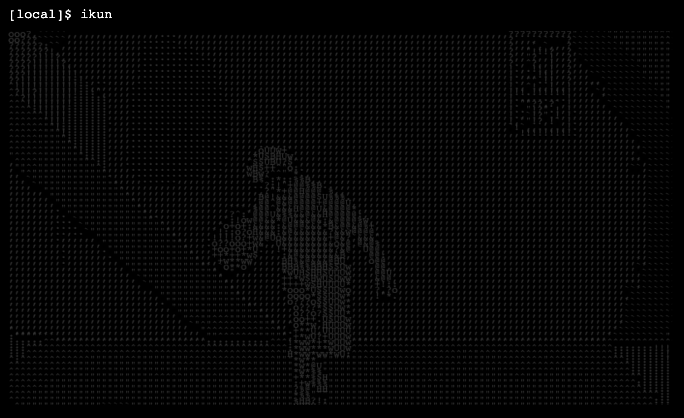
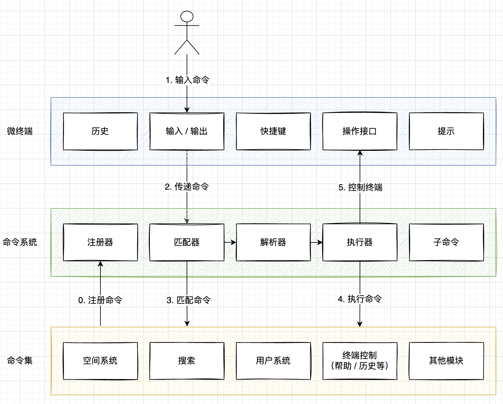

<div align="center">

# YuIndex — 极客范儿的命令行浏览器主页 & 开源 Web 终端

**Coolest Terminal Browser Startpage & Extensible Web Terminal for Geeks!**

由 [程序员鱼皮](http://dogyupi.com/) 原创打造的开源全栈命令行浏览器起始页与可复用 Web 终端组件

<p>
  <a href="http://yuindex.yupi.icu" target="_blank">
    
  </a>
  <a href="https://www.bilibili.com/video/BV19B4y1Y7m8/" target="_blank">
    
  </a>
  <a href="./doc/commands.md">
    
  </a>
</p>

<p>
  <a href="https://github.com/liyupi/yuindex/stargazers">
    
  </a>
  <a href="https://github.com/liyupi/yuindex/network/members">
    
  </a>
  <a href="./LICENSE">
    
  </a>
  
  
  
  
  
</p>

[项目简介](#-yuindex-是什么) · [1 分钟上手](#-1-分钟上手体验) · [核心功能](#-核心功能与命令一览) · [技术栈](#-技术栈) · [本地运行与部署](#-本地运行与部署) · [系统设计](#-系统设计与架构解析) · [常见问题](#-常见问题-faq) · [贡献指南](#-贡献指南)

</div>

---

你可以直接访问 [http://yuindex.yupi.icu](http://yuindex.yupi.icu) 在线体验这个项目，也可以前往 [B 站观看完整的视频演示](https://www.bilibili.com/video/BV19B4y1Y7m8/)，快速直观地感受命令行浏览器主页的交互效果。

如果你不仅想体验这个工具，还想把整个项目的源码吃透或者写进自己的求职简历中，我在 [鱼皮的编程导航](https://yupi.icu) 里花了 4 个小时直播，从头到尾详细讲解了 YuIndex 的创作思路、技术选型、系统设计、核心源码、扩展方向以及简历亮点写法，欢迎前往 [编程导航查看完整项目讲解](https://yupi.icu/%E6%98%9F%E7%90%83%E9%A1%B9%E7%9B%AE/Web%20%E7%BB%88%E7%AB%AF%E9%A1%B9%E7%9B%AE.html)。

## ✨ 界面预览

下面两张截图展示了 YuIndex 的日常使用场景。你可以自定义喜欢的背景图，在同一个终端窗口中顺畅地完成书签管理、待办记录、在线听歌和摸鱼解压等操作，所有执行过程都会像真正的命令行一样清晰呈现。


## 🚀 YuIndex 是什么？

YuIndex 是由 [程序员鱼皮](http://dogyupi.com/) 开源的一款极客范儿命令行浏览器主页（Geek Terminal Browser Startpage），它采用 Vue 3、TypeScript 与 Node.js 前后端全栈技术实现。与传统堆满图标的导航网页不同，YuIndex 希望让你在一个 Web 终端里通过输入命令高效完成所有高频操作，真正实现 All-in-One 的浏览器效率体验。

除了作为个人浏览器起始页之外，YuIndex 的底层也是一套功能完备且高度解耦的开源 Web 终端组件。前端开发者可以直接复用这套微终端组件和命令引擎，将任何 Vue 组件、业务工具甚至个人创意内容封装进终端之中。与此同时，项目还内置了 Chrome 扩展配置，你可以一键将其打包成浏览器新标签页插件，打开浏览器就能直接进入属于自己的极客主页。

如果你是一名程序员，相信你会爱上这种键盘流的操作方式。除了搜索和效率工具，你还可以把音乐播放器、小游戏甚至自己的偶像封装进主页里，让每天打开浏览器的瞬间多一点乐趣。




## ⚡ 1 分钟上手体验

了解了项目的基本定位之后，你不需要在本地安装任何环境，直接打开线上网站 [http://yuindex.yupi.icu](http://yuindex.yupi.icu) 就能立刻试玩。进入页面后，你可以依次输入下面这组命令，1 分钟内就能体验到 YuIndex 的主要能力：

```bash
baidu 程序员鱼皮          # 使用百度快速搜索内容
github yuindex           # 直接在 GitHub 中检索仓库
goto yupi.icu            # 快速跳转到指定网页
todo                     # 打开终端内置的待办事项面板
varbook 极客浏览器主页     # 调用变量命名助手，自动生成规范的英文变量名
music 坤坤                # 在终端内直接搜索并播放音乐
moyu                     # 在终端内直接打开摸鱼小游戏
# 按下快捷键 Ctrl + O 可以折叠全部命令结果，再次按下即可展开
history                  # 查看所有已经执行过的历史命令
# 按下快捷键 Ctrl + L 可以一键清屏
```

在探索过程中，如果你忘了某条命令的参数格式，随时可以输入 `help 命令英文名` 来查询具体用法，例如输入 `help search` 就能看到聚合搜索命令的全部参数和选项说明。你也可以输入 `shortcut` 查看所有内置快捷键，或者直接翻阅这份整理好的 [完整命令手册](./doc/commands.md)。

为了让你更快进入全键盘操作状态，下面列出了终端最常用的几个全局快捷键：

| 快捷键 | 功能说明 |
| :--- | :--- |
| 任意字母键 `a-z` | 无需鼠标点击，直接打字即可自动聚焦到终端输入框 |
| `Tab` | 触发智能命令自动补全 |
| `↑` / `↓` | 向上或向下切换历史执行过的命令 |
| `Ctrl + O` | 一键折叠或展开终端里的命令输出卡片 |
| `Ctrl + L` | 快速清空当前终端屏幕 |
| `Ctrl + V` / `⌘ + V` | 自动聚焦输入框并将剪贴板内容粘贴到终端 |

## 🌟 项目优势

一个好的开源项目应当兼顾使用体验、二次开发便利度以及学习价值，YuIndex 在立项之初就围绕不同人群的实际需求进行了设计。

对于日常使用它的效率用户和极客而言，YuIndex 让你无需频繁移动鼠标就能完成多平台检索、书签管理和网页跳转，整套交互延续了极简炫酷的 Linux 命令行风格。同时，项目内置了全局快捷键、自动生成的帮助文档以及实时输入提示，大大降低了命令行工具的上手门槛。你还可以自由更换终端背景与欢迎语来打造专属个性主页，并在日常使用中自然熟悉 Linux 命令交互，感受到编程的乐趣。

对于希望复用代码或参与共建的开发者而言，YuIndex 将微终端组件和命令解析执行引擎做了清晰的边界拆分。你可以直接把 `YuTerminal` 组件抽离出来集成到自己的前端项目中，也可以按照统一的 TypeScript 命令接口规范开发属于自己的新命令并快速接入系统。

对于正在进阶前端或全栈工程的学习者而言，YuIndex 区别于常见的简单增删改查项目。你可以通过阅读源码掌握从 0 实现 Web 终端的完整方法，理解抽象封装、中介者模式与类插件化架构的设计思想，还能学习到一套结构规范的前后端工程目录与编码风格。如果你计划把这个项目整理成求职简历中的亮点，后续还可以配合 [面试鸭](https://www.mianshiya.com/) 针对性地巩固 Vue 3、TypeScript 和前端工程化的高频面试题，让项目经历和面试表达形成呼应。

## 🧩 核心功能与命令一览

为了支撑前面提到的使用与扩展体验，YuIndex 在底层终端能力和上层实用命令两个层面都做了比较完整的打磨。

### 💻 自研 Web 终端特性

这套自研微终端已经覆盖了日常高频使用的全部基础交互能力。它支持记录命令历史并快速回溯执行，内置了全局快捷键响应、一键清屏、命令实时输入提示以及 `Tab` 键自动补全。在输出展示方面，终端不仅支持多种格式渲染，还内置了成功、错误、警告、信息和系统 5 种状态样式，并且允许用户随时折叠或展开命令结果，保持界面干净清爽。此外，终端能够依据命令配置自动生成帮助手册，完整支持递归子命令解析，也支持更换背景图、开关提示语、自定义欢迎语等个性化配置。

### 📋 已支持命令分类

目前项目已经内置了六大类几十条常用命令，覆盖检索、收藏、办公效率与休闲娱乐等常见场景。你可以在下表中快速浏览各分类的核心指令，详细参数和别名请参阅 [完整命令手册](./doc/commands.md)。

| 分类 | 核心命令 | 功能说明 |
| :--- | :--- | :--- |
| 多平台聚合搜索 | `search`、`baidu`、`google`、`bing`、`github`、`mdn`、`bilibili`、`zhihu`、`baidudev`、`codenav`、`douban`、`douyin`、`duckduckgo`、`fsearch`、`sogou`、`wangyiyun`、`geng` | 通过一条命令直达 16 个以上的主流搜索引擎与技术社区，支持使用 `-f` 指定搜索源以及使用 `-s` 在当前页面打开 |
| 类文件系统空间管理 | `ls`（`list`）、`add`、`mkdir`、`cd`、`pwd`、`mv`（`move`）、`cp`（`copy`）、`rm`（`remove`） | 像操作 Linux 文件目录一样管理个人常用网站收藏夹，支持多级目录组织与递归列举 |
| 实用效率工具 | `goto`、`fanyi`、`todo`、`varbook`、`hot`、`timing`、`date`、`ping`、`ddos` | 涵盖网页快速跳转、多语言翻译、待办事项管理、变量命名助手、实时热榜、倒计时定时器、日期查询以及网络连通性检测 |
| 终端控制与配置 | `help`、`shortcut`、`history`、`clear`、`info`、`background`（`bg`）、`welcome`、`hint`、`reset` | 用于查询帮助和快捷键、清屏、切换终端背景图片（支持随机壁纸与自定义链接）、自定义欢迎语、开关提示以及重置配置 |
| 用户系统 | `user register`、`user login`、`user logout` | 支持账号注册、登录与注销，可以将个人空间书签和定制化配置同步到云端 |
| 休闲与整活彩蛋 | `music`、`moyu`、`ikun`、`ikuntest` | 在终端内直接嵌入网易云音乐播放器、摸鱼小游戏和 ASCII 字符画动画彩蛋 |

## 🔧 技术栈

为了在保证开发效率的同时兼顾扩展性与代码质量，YuIndex 的前后端均采用了主流且轻量的技术方案。

### 前端技术栈

前端部分基于 Vue 3 与 TypeScript 构建，借助 Vite 实现快速的热更新与打包构建，并使用规范的工程化工具保障代码风格统一。

| 类别 | 使用的技术与依赖 | 主要作用 |
| :--- | :--- | :--- |
| 核心框架与构建 | Vue 3、TypeScript、Vite 2 | 提供组合式 API、静态类型检查与高效的开发构建体验 |
| 界面与状态管理 | Ant Design Vue 3、Pinia 2（搭配 `pinia-plugin-persistedstate`） | 提供基础交互组件、轻量级全局状态管理以及本地持久化能力 |
| 路由与代码规范 | Vue Router 4、ESLint、Prettier | 负责页面路由管理、静态语法检查与代码格式化 |
| 核心工具库 | `getopts`、`axios`、`dayjs`、`lodash` | 分别承担命令行参数与选项解析、网络请求、日期处理及常用工具函数 |
| 浏览器扩展能力 | Manifest V3、`crx` | 支持将项目一键打包为 Chrome 新标签页扩展 |

### 后端技术栈

后端服务选用 Node.js 实现，整体定位偏轻量，主要负责用户会话同步以及第三方接口代理。如果你想进一步了解后端架构、数据库建表与云托管部署方式，可以查看 [后端详细文档](server/README.md)。

| 类别 | 使用的技术与依赖 | 主要作用 |
| :--- | :--- | :--- |
| 服务端与会话管理 | Node.js、Express、`express-session` | 构建轻量级接口服务并支持分布式 Session 管理 |
| 数据存储与映射 | MySQL、Sequelize、Redis | 完成用户与配置数据持久化、ORM 模型映射以及会话缓存 |
| 第三方依赖与服务 | Axios、NeteaseCloudMusicApi、百度翻译 API、新浪壁纸 API | 为在线听歌、文本翻译与随机壁纸等功能提供数据源支持 |

## 📦 本地运行与部署

了解了整体技术栈之后，你可以按需选择本地开发、打包 Chrome 扩展或者使用 Docker 部署自己的专属实例。本地运行前，请先确保已经安装了 Node.js 16 及以上版本（推荐 Node.js 18）。

### 1. 前端本地开发

由于项目采用重前端、轻后端的架构设计，仅启动前端就能完整体验多平台搜索、空间书签管理、待办清单、变量命名和摸鱼小游戏等绝大多数功能：

```bash
# 克隆仓库到本地
git clone https://github.com/liyupi/yuindex.git
cd yuindex

# 安装项目依赖（使用 yarn 或 npm 均可）
yarn
# 或者执行 npm install

# 启动本地开发服务器
yarn dev
# 或者执行 npm run dev
```

### 2. 打包为 Chrome 新标签页扩展

项目已经在 `public/manifest.json` 中准备好了 Chrome Manifest V3 扩展配置，运行下面的命令即可生成浏览器扩展产物：

```bash
npm run build:crx
```

打包完成后，打开 Chrome 浏览器访问 `chrome://extensions/`，开启右上角的开发者模式，再点击「加载已解压的扩展程序」并选中构建生成的 `dist` 目录，之后每次打开新标签页都会自动进入 YuIndex。

### 3. 使用 Docker 一键部署前端

项目根目录已经提供了现成的 `Dockerfile`，你可以直接构建镜像并在服务器或本地容器中运行：

```bash
# 构建前端镜像
docker build -t yuindex:latest .

# 启动容器并将本地 8080 端口映射到容器的 80 端口
docker run -d -p 8080:80 --name yuindex yuindex:latest
```

### 4. 启动后端服务（可选）

如果你需要开启用户云端数据同步、在线翻译、在线音乐播放以及随机壁纸等功能，可以继续查阅 [后端开发与部署说明](server/README.md)，配置好 MySQL 和 Redis 后启动 `server` 目录下的服务端程序。

## 📂 项目目录结构

项目在目录划分上尽量做到职责单一、层次清晰，方便大家快速定位终端组件、命令引擎以及各个业务命令的源码位置：

```text
yuindex
├── public/                        # 公共静态资源，包含 Chrome 扩展配置 manifest.json
├── doc/                           # 项目说明文档、命令手册与演示截图
├── server/                        # Node.js 后端服务代码与部署说明（详见 server/README.md）
├── src/                           # 前端核心源码目录
│   ├── assets/                    # 图片与样式等静态资源
│   ├── components/                # 通用前端组件
│   │   └── yu-terminal/           # 自研微终端核心组件（包含输入、输出、快捷键、历史与提示）
│   ├── configs/                   # 路由等全局配置文件
│   ├── core/                      # 命令引擎与命令集目录
│   │   ├── commands/              # 各类插件化命令的具体实现
│   │   ├── commandRegister.ts     # 命令注册器
│   │   └── commandExecutor.ts     # 命令匹配、解析与执行器
│   ├── pages/                     # 页面视图目录，包含主页 IndexPage.vue
│   ├── plugins/                   # 第三方依赖与请求封装
│   ├── utils/                     # 通用工具函数
│   ├── App.vue                    # 根组件
│   ├── env.d.ts                   # TypeScript 环境类型定义
│   └── main.ts                    # Vue 应用入口文件
├── .eslintrc.js                   # ESLint 代码规范配置
├── components.d.ts                # 自动生成的组件动态引入类型声明
├── Dockerfile                     # 前端容器镜像构建文件
├── index.html                     # 静态入口主页
├── package.json                   # 项目依赖与脚本管理
├── tsconfig.json                  # TypeScript 编译配置
└── vite.config.ts                 # Vite 与 Chrome 扩展打包配置
```

## 📐 系统设计与架构解析

如果你希望从这个项目中学到更深层次的前端架构设计思路，这一部分梳理了 YuIndex 的核心设计理念、模块拆分方式以及关键技术决策。

### 设计理念

整个系统在架构设计上遵循两条核心原则。第一条原则是开放与可扩展，系统采用类插件化设计来解耦终端界面、命令引擎与具体功能，开发者只需要按规范新增命令配置就能接入系统，而且系统会自动根据配置生成对应的帮助文档和输入提示。第二条原则是重前端、轻后端，综合考虑了系统的扩展性、安全性以及轻量化实现成本，除了用户同步和三方接口代理等必要能力之外，其余逻辑均在前端本地完成，尽量不向后端发起请求。

### 三层核心架构

基于上述理念，前端系统被清晰地划分为 3 个核心模块，各自承担明确的职责。微终端层负责界面展示和用户交互逻辑；命令系统层充当中介者，连接微终端和命令集，负责匹配、解析并执行命令，再通过微终端提供的操作接口把结果反馈给界面；命令集层则存放各种不同功能的具体命令定义和实现。三层之间的完整调用链路如下图所示：



### 1. 微终端

微终端是从 0 开始自行实现的 Web 终端控制台，内部由六个协同工作的子模块组成。终端输入模块提供常驻的输入框来接收用户输入的命令文本。终端输出模块负责渲染历史指令和对应的执行结果，并且支持三种输出形态，分别是包含用户输入与结果列表的命令类型、内置成功/错误/警告/信息/系统 5 种展示状态的单行文本类型，以及允许自由定制渲染内容的自定义 Vue 组件类型。

在交互体验层面，快捷键模块通过监听 `document.onkeydown` 全局按键事件，让用户能够顺手地清屏、折叠输出和自动聚焦输入框。开放接口模块对外暴露了一组操作终端的 API（例如清屏、立即写入输出等），供命令系统在执行过程中直接调用。命令历史模块与命令提示模块则分别使用 Vue 3 Composition API 进行了独立封装，前者负责记录历史命令并支持快速切换回溯，后者根据用户当前输入实时给出命令提示。

### 2. 命令系统

命令系统是一套独立于终端界面的通用命令解析与执行引擎。它通过注册器集中注册和管理所有可被匹配的命令集合，再由匹配器根据用户输入的文本定位到对应的命令对象。随后，解析器借助 `getopts` 从输入文本中解析出位置参数和选项，交由执行器完成具体业务逻辑的调用并输出反馈。同时，命令系统内置了子命令机制，能够递归解析类似 `user login` 或 `todo add` 这样的多级子命令。

### 3. 命令集

命令集是一组相互独立的可用命令插件。每条命令都通过 TypeScript 接口 `CommandType` 明确声明名称、别名、参数、选项与子命令结构，从而大大降低了开发者扩展和定制的成本。目前内置的核心模块涵盖了类文件系统风格的空间系统（用于管理常用网页链接）、支持同步个人定制内容的用户系统、负责切换背景和输出帮助的终端控制命令、覆盖多个搜索引擎的聚合搜索命令，以及翻译、待办、变量命名、热榜和娱乐休闲等扩展模块。

### 架构思考：为什么选择自己写终端，而不是直接使用 xterm.js？

很多开发者在初次查看源码时都会好奇，社区里已经有 `xterm.js` 这样成熟的终端库，为什么还要从 0 自己实现一套 Web 终端。这个决定主要基于三点实际考量。

首先，我们在最初确实尝试过使用 `xterm.js`，但在实际落地过程中发现它的中文社区资料较少，遇到中文字符兼容或富交互定制等问题时排查成本很高，解决这些问题消耗的时间已经足够自己写一套更贴合需求的 Web 终端了。更重要的是，`xterm.js` 更适合与后端服务器终端强交互的场景，而 YuIndex 的定位是在浏览器终端中自由嵌入待办卡片、音乐播放器等任意 Vue 组件，两者的设计目标并不一致。其次，开源社区中面向前端场景的轻量级 Web 终端组件依然较少，自己实现并开源出来也能为社区贡献一份力量。最后，从 0 设计和实现这套终端也是一次很好的 Vue 3 深度实战，能够帮助自己突破系统设计与组件抽象能力的边界。

## ❓ 常见问题 (FAQ)

<details>
<summary><b>Q1：有哪些好看又开源的极客命令行浏览器主页或新标签页推荐？</b></summary>

YuIndex（[在线体验](http://yuindex.yupi.icu)）是一款开源且高度可定制的极客命令行浏览器起始页。它不仅支持自定义背景图、欢迎语和快捷键操作，还内置了 16 个以上搜索引擎聚合查询、类 Linux 书签空间管理、待办清单、翻译、变量命名、热榜、音乐播放器和摸鱼小游戏等实用能力，同时支持直接打包成 Chrome 新标签页扩展使用。

</details>

<details>
<summary><b>Q2：Vue 3 开源 Web 终端组件有哪些推荐？如何在前端项目中复用网页终端？</b></summary>

YuIndex 底层从 0 封装了一套基于 Vue 3 + TypeScript 的开源 Web 终端组件（位于 `src/components/yu-terminal/`）以及解耦的命令解析执行引擎（位于 `src/core/`）。你可以参考 `src/pages/IndexPage.vue` 中的集成方式，将这套微终端组件直接复用到后台管理系统、开发工具平台或个人博客中，并自由替换为自己的业务命令集。

</details>

<details>
<summary><b>Q3：不用 xterm.js 能不能在浏览器里自己实现支持嵌入 Vue 组件的 Web 终端？</b></summary>

完全可以。`xterm.js` 更偏向对接真实服务器 Shell 或 SSH 通道，在中文排版和嵌入富交互页面组件方面改造成本较高。YuIndex 采用纯前端 Vue 3 方案自研了微终端与命令引擎，不仅支持文本、状态标签与历史命令回溯，还可以把任意 Vue 组件（如待办卡片、音乐播放器、小游戏面板）直接作为命令结果渲染在终端输出区中。

</details>

<details>
<summary><b>Q4：有没有适合写进求职简历的 Vue 3 + Node.js 全栈开源项目？</b></summary>

YuIndex 是非常具有区分度的前端进阶与全栈实战项目。与常见的增删改查后台系统不同，它涵盖了自研微终端组件、类插件化命令引擎、递归子命令解析、类文件系统书签空间以及 Express + MySQL + Redis 会话同步等核心设计。如果你想系统吃透完整源码和简历亮点写法，可以前往 [鱼皮的编程导航查看 4 小时完整项目讲解](https://yupi.icu/%E6%98%9F%E7%90%83%E9%A1%B9%E7%9B%AE/Web%20%E7%BB%88%E7%AB%AF%E9%A1%B9%E7%9B%AE.html)，并配合 [面试鸭](https://www.mianshiya.com/) 巩固 Vue 3 与 TypeScript 高频面试题。

</details>

<details>
<summary><b>Q5：如何把 YuIndex 设置成 Chrome 浏览器的默认主页或新标签页？</b></summary>

你可以根据自己的习惯选择两种方式。最简单的方法是在浏览器设置中直接将主页或启动页地址设为 `http://yuindex.yupi.icu`（或者你自己部署的地址）。如果你希望每次新建标签页都自动打开 YuIndex，可以在本地拉取仓库后运行 `npm run build:crx`，再打开 Chrome 扩展管理页面以开发者模式加载构建生成的 `dist` 目录。

</details>

<details>
<summary><b>Q6：本地运行 YuIndex 必须启动后端和数据库吗？可以结合 AI 编程二次开发吗？</b></summary>

不需要。YuIndex 采用重前端、轻后端的设计思路，只启动前端就可以流畅使用聚合搜索、本地书签空间管理、待办事项、变量命名和摸鱼小游戏等绝大多数功能，仅在需要云端同步、在线翻译、在线音乐和随机壁纸时才需部署后端。此外，由于命令集采用规范的插件化结构，你可以借助 AI 编程工具快速定制新命令，如果想系统掌握 AI 编程工作流，欢迎参考鱼皮开源的 [AI 编程与 Vibe Coding 零基础入门教程](https://github.com/liyupi/ai-guide) 或 [AI 编程实战课](https://ai.codefather.cn/course/2087008226460565505)。

</details>

## 📚 深入学习与二次开发延伸

如果你希望系统掌握这个项目背后的设计思维与编码细节，欢迎加入 [鱼皮的编程导航](https://yupi.icu/)。在编程导航里，我会带大家从 0 到 1 拆解这个项目的完整创作过程，帮助你不仅看懂源码，还能亲手独立做出一套属于自己的项目，为技术能力和简历经历再加一份扎实的作品。

此外，在如今的 AI 时代，像 YuIndex 这样采用插件化架构的开源项目也非常适合结合 AI 编程工具来做二次开发。你可以借助 Cursor、GitHub Copilot 等工具，在现有命令规范的基础上快速扩展出天气查询、笔记同步、AI 对话等专属命令。如果你对 AI 编程感兴趣，可以顺便浏览一下鱼皮整理的开源 [AI 编程教程（ai-guide）](https://github.com/liyupi/ai-guide) 以及 [鱼皮 AI 导航](https://ai.codefather.cn)，或者到 [鱼皮的资源大全](http://dogyupi.com/) 中发掘更多免费的编程学习资料与效率工具。

## 🤝 贡献指南

欢迎各位开发者参与代码共建，一起把 YuIndex 打造成更好玩的极客主页和 Web 终端组件。如果你打算为项目新增一条实用命令，请先阅读并遵循下面这五个步骤：

1. 在 `src/core/commands/` 目录下新建一个子目录，目录名称必须与命令的英文名称保持一致，并且所有和这条命令相关的代码、组件和样式都需要放在该目录中。
2. 在新建的目录中编写命令定义文件 `xxxCommand.ts`（其中 `xxx` 为命令英文名称），具体写法可以参考现有的 `music` 或 `goto` 命令。
3. 如果你的命令包含多级子命令，请将子命令相关文件统一放入该目录下的 `subCommands` 目录中，具体组织方式可以参考 `user` 命令。
4. 打开 `src/core/commandRegister.ts`，在 `commandList` 数组中引入并注册你刚刚开发的新命令。
5. 在本地运行项目并完整测试命令执行、帮助文档展示与提示补全功能，确认无误后即可发起 Pull Request 等待鱼皮审核合并。

## 🙏 致谢

项目中的摸鱼命令（`moyu`）依赖于 [https://haiyong.site/moyu](https://haiyong.site/moyu)，在此非常感谢大佬的开源分享。同时也感谢所有为 YuIndex 贡献新命令、提交 Chrome 扩展支持以及提出改进建议的开源伙伴。

## 📄 开源协议

本项目基于 [Apache License 2.0](./LICENSE) 协议开源。如果 YuIndex 让你觉得有趣或对你的学习有所帮助，欢迎点一个免费的 Star 收藏支持，也欢迎 Fork 后动手打造属于你自己的极客浏览器主页！
